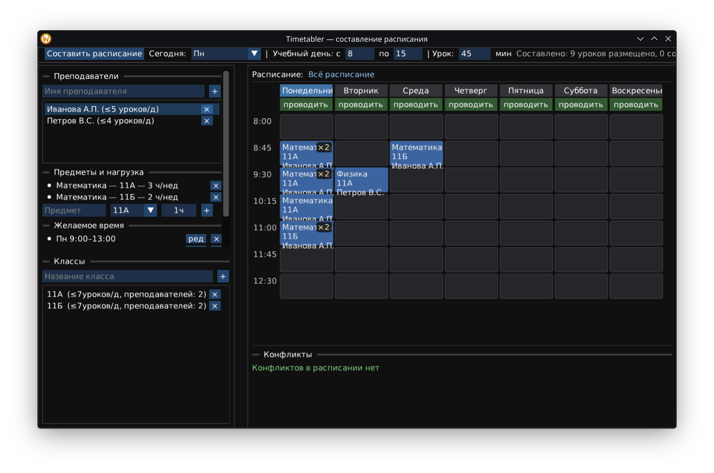

# Timetabler

Program that builds a weekly schedule for teachers.

For each teacher you enter the subject, class, weekly hours and the days and hours when they want to teach. Timetabler puts the lessons on a weekly grid. It keeps teachers and classes from overlapping, caps the number of lessons per day and skips disabled days.

When a lesson doesn't fit into the slot a teacher asked for, the conflicts panel says why. You can fix the result by hand: drag a lesson to move it, right-click to lock, unlock or cancel it.

## Screenshots




## Ubuntu dependencies

For ImGui with GLFW backend the following packages must be installed
```
libx11-dev libxrandr-dev libxinerama-dev libxcursor-dev libxi-dev freeglut3-dev
```
